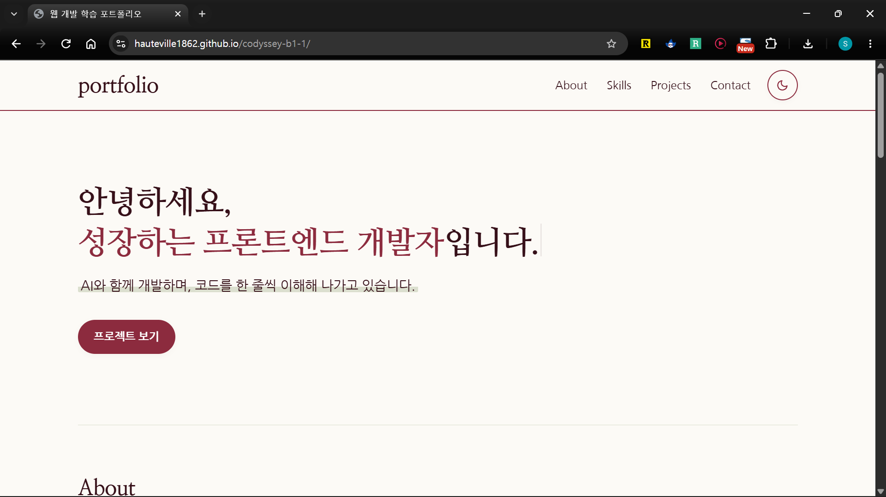
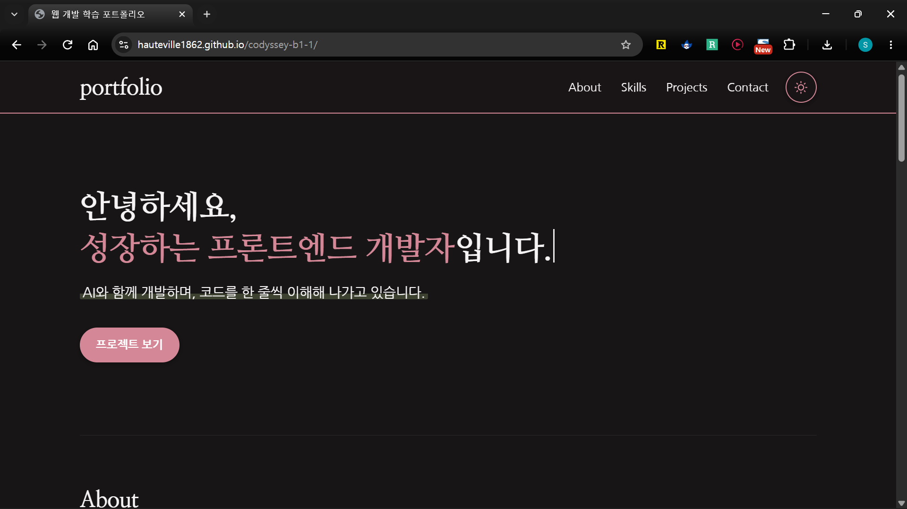
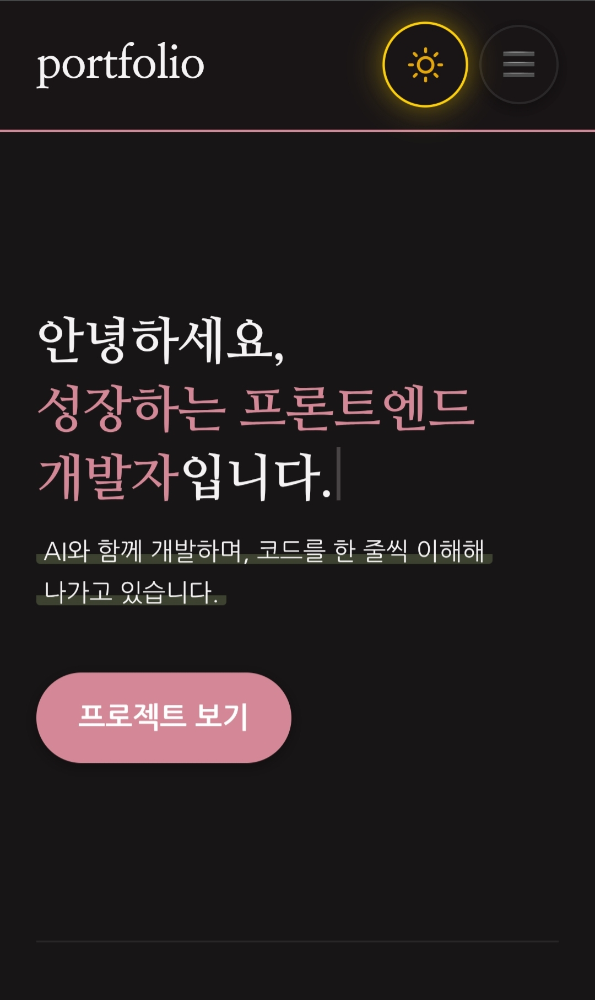

# B1-1 개발자 포트폴리오

HTML, CSS, JavaScript로 만든 반응형 자기소개 웹사이트입니다. 다크 모드, 폼 검증, GitHub 저장소 목록을 제공합니다.

## 사용 기술

HTML5, CSS3, JavaScript (ES6+), GitHub REST API, GitHub Pages, Google Fonts를 사용했습니다.

## 배포 URL

[웹사이트 보기](https://hauteville1862.github.io/codyssey-b1-1/)

## 동작 기준

- 맨 위로 버튼: 스크롤 300px 이상
- 네비게이션 배경 변경: 스크롤 60px 이상
- 스크롤 등장 효과: Intersection Observer 임계값 0.2

## 스크린샷

| 화면 구분 | 라이트 모드 (기본 테마) | 다크 모드 (야간 테마) |
| :---: | :---: | :---: |
| **데스크톱** (1024px+) |  |  |
| **모바일** (<768px) |  |  |

## 평가기준

### [항목 1](<eveluation/항목 1>)

1-1. 브라우저 창 크기를 줄였을 때 레이아웃이 모바일에 맞게 변경되는가?

1-2. 테마 토글 버튼 클릭 시 다크/라이트 모드가 전환되고, 새로고침 후에도 유지되는가?

1-3. 햄버거 메뉴, 스크롤 애니메이션, 맨 위로 가기 버튼 등이 정상 동작하는가?

1-4. GitHub API에서 데이터를 불러와 화면에 표시되고, 로딩/에러/빈 상태가 구분되는가?

1-5. 필수 입력값 누락, 이메일 형식 오류 시 즉각적인 피드백이 표시되는가?

### 항목 2

2-1. HTML, CSS, JavaScript가 각각의 파일로 분리되어 있고, 분리한 이유와 각 파일의 역할을 구분하여 답변할 수 있는가?

2-2. header, nav, main, section, footer 등 시맨틱 태그를 사용했고, 어떤 기준으로 태그를 선택했는지 설명할 수 있는가?

2-3. CSS 변수(:root)로 색상, 폰트 등을 정의했고, 변수로 관리하면 어떤 이점이 있는지 구체적으로 답변할 수 있는가?

2-4. onclick 인라인 속성 대신 addEventListener를 사용한 이유를 두 방식의 차이를 비교하여 제시할 수 있는가?

### 항목 3

3-1. 다크 모드, API 호출, 폼 유효성 검사 중 하나를 예시로 들어, "이벤트 → 상태 변경 → 화면 업데이트" 흐름이 코드에서 어떻게 이어지는지 따라가며 짚어줄 수 있는가?

3-2. async/await와 try/catch를 사용하여 API 호출 성공과 실패를 어떻게 분기 처리했는지 코드 흐름을 따라 답변할 수 있는가?

3-3. map, filter 등 배열 메서드를 활용하여 GitHub 데이터를 카드 UI로 변환하는 과정을 단계별로 정리할 수 있는가?

3-4. Flexbox와 Grid를 각각 어디에 적용했는지 확인하고 해당 상황에서 그 방식을 선택한 이유를 비교하여 설명할 수 있는가?

### 항목 4

4-1. 상태(STATE) 객체를 따로 만들어 관리한 이유는 무엇이며, 그냥 변수로 처리하면 안 되는지 설명할 수 있는가?

4-2. 반응형 디자인에서 "모바일 퍼스트"로 작성한 이유를 이야기할 수 있는가?
